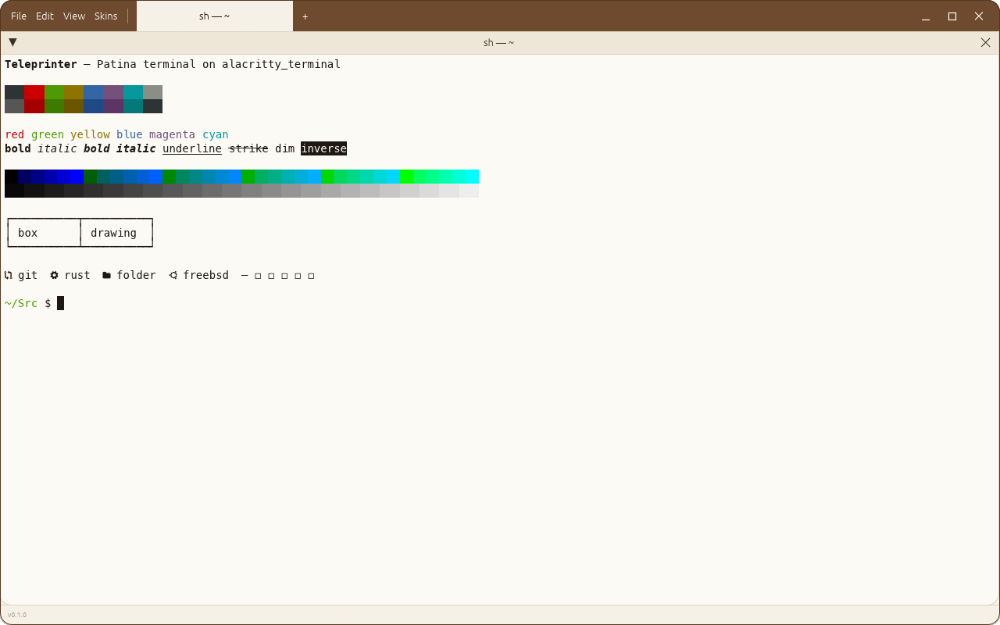
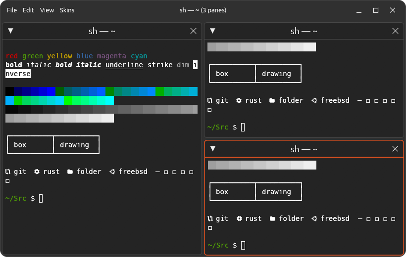
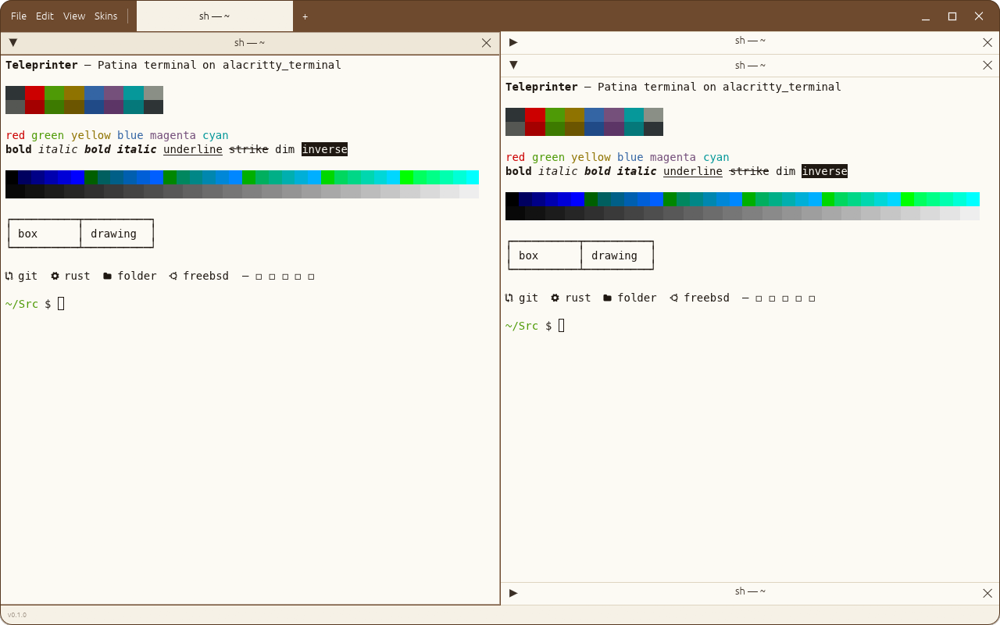

#  Teleprinter

A terminal emulator in the [Patina](https://github.com/Sector-F-Labs/patina) family: Patina's
window frame and skins, following the desktop's light/dark setting, with
[`alacritty_terminal`](https://crates.io/crates/alacritty_terminal) doing the emulation and
MesloLGS NF as the font.



Right-click a terminal to **Split Right** or **Split Down**. Panes tile the window, each in a
window of its own titled with what's running in it and where, as tmux names its windows
(`vim — ~/Src/teleprinter`, back to `zsh — ~/Src/teleprinter` when vim exits). Drag a pane's title bar onto another to move it to that side, as
in a tiling window manager (hold still over a pane to swap the two instead), and drag the border
between panes to resize. Collapse a pane with the arrow on its title bar (or
double-click the title): in a stack, its neighbours take the space, so a column can hold many
folded panes whose titles still show what's running.

Tabs sit in the title bar, after the menus: each is a layout of panes of its own, named for its
active pane. Panes touch by default; View → Gaps Between Panes spaces them out (`gap = 4.0` in
`~/.config/teleprinter/config.toml`, or any other width). Pane title bars are 28 points tall;
`pane_title_height` there changes that.





Each skin colours the terminal too. Skins can set their own palette under `[app.teleprinter]`
(`foreground`, `background`, `cursor`, `selection`, `black` … `bright_white`); anything left out
comes from the skin's own colours and a light or dark Tango palette.

## Shortcuts

| Keys | Does |
|------|------|
| Ctrl+Shift+C | Copy the selection |
| Ctrl+Shift+V | Paste |
| Shift+Page Up / Down | Scroll back through history |
| Mouse drag / double / triple click | Select text / a word / lines |
| Right-click → Split Right / Split Down | Split the pane (also on its title bar, and in File) |
| Drag a pane's title bar onto another | Move it to that side of the other pane |
| …and hold still before letting go | Swap the two panes |
| Right-click the background | New Terminal in that space |
| Drag the border between panes | Resize them |
| Ctrl+Shift+T, or + in the title bar | New tab |
| Ctrl+Page Up / Down | Previous / next tab |
| Middle-click a tab, or its × | Close the tab and its panes |
| Title bar arrow, or double-click the title | Collapse / expand the pane |
| Mouse wheel | Scroll history (arrow keys in full-screen programs like `less`) |

Ctrl+C, Ctrl+V and the rest go to the shell as usual.

## Build

```sh
make            # list the targets
make run        # run it
make check      # tests and clippy
make screenshot # regenerate docs/screenshot-*.png
make install    # per user, into ~/.local (PREFIX=… to change), with launcher and icon
make uninstall  # remove it again
make icons      # re-render assets/teleprinter-icon-128.png from packaging/linux/teleprinter.svg
```

## Status

A first prototype. Not yet: keyboard shortcuts for splitting and moving between panes, saving the
layout, reordering tabs or moving panes between them, input methods, choosing a font, fonts for
CJK and other scripts Meslo lacks.

## Licence

BSD-3-Clause. The bundled MesloLGS NF fonts are Apache 2.0; see `assets/fonts/`.
