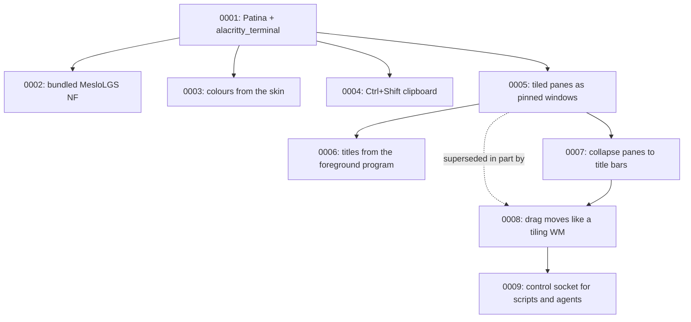

# Architecture Decision Records

This directory holds ADRs for Teleprinter — short records of significant architecture decisions,
written at the time they're made, following Michael Nygard's format as popularized by Martin
Fowler: <https://martinfowler.com/bliki/ArchitectureDecisionRecord.html>.

## When to write one

Write an ADR when a decision is:

- Hard, or expensive, to reverse once other code depends on it.
- Not obvious from reading the code — a "why", not a "what".
- The kind of thing that'll get re-litigated later without a record ("didn't we already decide
  this?").

Small, reversible choices don't need one. Rule of thumb: if you'd want to explain the choice to a
new contributor in a paragraph beyond what the code itself shows, it's ADR-sized.

An ADR is a point-in-time record of *a decision as it was made*, including the options considered
and rejected. It does not get rewritten later — a decision that reverses or replaces an earlier one
gets its own new ADR that supersedes the old one, which stays in place with its status updated.

## Convention

- One file per decision: `NNNN-short-kebab-title.md`, numbered sequentially, zero-padded to 4
  digits. Numbers are never reused, even for a decision that gets reversed.
- Start from [`0000-template.md`](0000-template.md) — copy it, don't write from scratch.
- `Status` is one of: `Proposed`, `Accepted`, `Rejected`, `Deprecated`, or `Superseded by
  ADR-NNNN` (linked to the superseding record).
- Every new ADR gets a row in the index below.
- Keep records short — a paragraph or two per section is normal. An ADR documents a decision and
  its reasoning, not a design document.

Teleprinter is a [Patina](https://github.com/Sector-F-Labs/patina) app. Decisions about the shared
frame, skins and components are recorded in Patina's own ADRs; record here only what this app
decides.

If you're working with Claude Code in this repo, `.claude/skills/adr/SKILL.md` automates the
mechanics of adding one.

## Index

| # | Title | Status |
|---|-------|--------|
| [0001](0001-build-on-patina-with-alacritty-terminal.md) | Build Teleprinter on Patina, with alacritty_terminal for the emulation | Accepted |
| [0002](0002-bundle-meslolgs-nf.md) | Bundle MesloLGS NF as the terminal font | Accepted |
| [0003](0003-terminal-colours-come-from-the-skin.md) | Terminal colours come from the skin | Proposed |
| [0004](0004-ctrl-shift-for-the-clipboard.md) | Ctrl+Shift+C/V for the clipboard; Ctrl+C stays an interrupt | Proposed |
| [0005](0005-tiled-panes-as-pinned-windows.md) | Split into tiled panes, each a pinned window, swapped by dragging | Accepted, partly superseded by [0008](0008-drag-moves-panes-like-a-tiling-window-manager.md) |
| [0006](0006-pane-titles-from-the-foreground-process.md) | Pane titles follow the foreground program, as tmux names windows | Accepted |
| [0007](0007-collapse-panes-to-their-title-bars.md) | Collapse panes to their title bars, and give the space to their neighbours | Accepted |
| [0008](0008-drag-moves-panes-like-a-tiling-window-manager.md) | Dragging moves a pane like a tiling window manager; holding still swaps | Accepted |
| [0009](0009-control-socket-for-scripts-and-agents.md) | A control socket lets programs in a pane open, move and close panes | Proposed |

## Decision Relationship

## Revisit Triggers

- egui's text layout can't keep up with fast output (`cat` of a large file stutters): consider
  caching rows or a glyph atlas of our own ([0001](0001-build-on-patina-with-alacritty-terminal.md)).
- A second app wants tiles of pinned windows with drag-to-swap (UnAmp already tiles): move
  `tiles.rs` and the pane handling into Patina ([0005](0005-tiled-panes-as-pinned-windows.md)).
- A second Patina app wants a monospace font: move Meslo into Patina
  ([0002](0002-bundle-meslolgs-nf.md)).
- A second app wants an ANSI palette (e.g. a log viewer): move the palette keys into Patina's shared
  skin format ([0003](0003-terminal-colours-come-from-the-skin.md)).
- Agents want to type into panes they didn't open, or clean up what they opened: revisit
  `send-text` and pane ownership ([0009](0009-control-socket-for-scripts-and-agents.md)).
